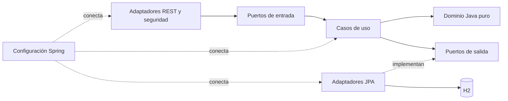

# Evolución a arquitectura hexagonal

## Estado y ramas

Trabajo en `Brayan-Cordoba-Branch`. Se consultó `origin` y se incorporó `origin/main` mediante avance rápido desde `f384bb0` hasta `9225927` (20 commits). `origin/Deivid-Canan-Branch` ya está incluido en ese main. La evolución se organiza en commits de dominio/aplicación, infraestructura y documentación, conservando el historial del equipo.

## Dependencias y paquetes

- `domain/entity`, `domain/valueObject`: reglas e invariantes sin Spring, Jakarta ni JPA. Los constructores son privados y asignan estado. Las fábricas `crear(...)` validan antes de construir. Los cuatro VO que eran records ahora son clases inmutables con fábrica, igualdad por valor y los mismos accessors.
- `application/port/in`: contratos usados por los controladores; `application/usecase`: implementaciones independientes de Spring.
- `domain/repository`: puertos de salida originales de inventario y pedidos. No hace falta moverlos para que la arquitectura sea hexagonal.
- `application/port/out`: puertos de cuentas, codificación de claves, presentaciones y certificados.
- `application/dto/request`: datos solicitados al usuario, con Jakarta Validation. `application/dto/response`: respuestas independientes; nunca devuelven contraseñas ni hashes.
- `infrastructure/web` y `infrastructure/security`: adaptadores de entrada, validación `@Valid`, sesiones, CSRF y permisos.
- `infrastructure/persistence/jpa`: entidades de persistencia separadas del dominio, mapeo e implementación de los puertos.
- `infrastructure/config`: ensamblado y límites transaccionales. Una operación de aplicación se ejecuta dentro de una transacción. La extracción carga la botella con bloqueo de escritura para evitar que dos solicitudes consuman el mismo volumen.
- Los adaptadores en memoria siguen disponibles para las pruebas unitarias; la aplicación utiliza JPA/H2.

## Reglas acordadas y decisiones explícitas

1. Las presentaciones admiten cualquier volumen positivo, incluyendo 30, 50 y 100 ml. No se usa un enum para tamaños porque son variables. Un decant siempre es menor que la botella madre correspondiente, conforme a la regla existente.
2. Cada presentación tiene precio propio en COP. `Presentacion.validarPrecio` exige precio positivo, máximo 12 enteros y dos decimales; usa `BigDecimal` y no redondea silenciosamente. No se inventó un recargo por importación ni una fórmula proporcional al volumen.
3. `OrigenProducto` distingue `NACIONAL` e `IMPORTADO`. Por el contexto colombiano del proyecto, nacional requiere país `CO`; importado requiere otro código ISO de país. El origen no establece calidad ni autenticidad. Concentración y pirámide olfativa siguen siendo características separadas.
4. Clientes y vendedores registran nombre, cédula, correo, clave y rol. Se aplica unicidad de correo/cédula y normalización del correo. La regla provisional de cédula es entre 5 y 15 dígitos: valida formato, no identidad real ni un registro oficial.
5. El registro público solo permite `CLIENTE` y `VENDEDOR`. `ADMIN` se provisiona fuera de ese registro, mediante configuración local inicial. Las claves se almacenan con BCrypt; mínimo 10 caracteres y máximo 72 bytes.
6. La autenticidad corresponde a cada presentación: si se anuncia como original, requiere certificado aprobado antes de publicarse. PDF, PNG o JPEG, máximo 5 MB, con comprobación inicial de firma y tipo. La revisión humana del administrador es la que aprueba o rechaza; no existe verificación automática con fabricantes ni análisis antivirus.
7. El certificado solo puede consultarlo su vendedor o un administrador. Subir otro archivo devuelve el certificado a `PENDIENTE` y retira la presentación del catálogo. Un rechazo también la retira. Un vendedor no puede aprobarse a sí mismo ni cambiar documentos de otro vendedor.
8. `TipoEmpaque`: `ESTANDAR` o `REGALO`. Los testers rechazan regalo. El endpoint valida la selección; aún no guarda un empaque en un pedido ni cobra un recargo.

## Alcance funcional

El inventario de botellas se administra de forma central mediante el rol ADMIN. Los vendedores registran sus propias presentaciones y precios sobre las fragancias disponibles. Esta decisión evita dar a todos los vendedores permisos de extracción o eliminación sobre botellas ajenas mientras no exista un modelo de propiedad de inventario por vendedor.

Crear una presentación de tipo DECANT registra una oferta/tamaño/precio; no extrae líquido. La extracción física sigue siendo el caso de uso CrearDecant. El checkout futuro deberá coordinar la presentación comprada, las existencias y la extracción/reserva.

Se conserva el modelo y repositorio de pedidos, ahora con persistencia H2. No se han añadido carrito, checkout, pagos, envíos, interfaces gráficas ni los casos de uso pendientes de realizar/cancelar pedidos. El precio de las líneas históricas conserva la API anterior `Double`; migrarlo a `BigDecimal` debe acompañar el desarrollo del checkout.

## H2 y futura MariaDB

H2 es el perfil predeterminado. Guarda datos en `Ecomerce-PureObsession/data/pureobsession` y conserva datos entre reinicios. Esa carpeta está excluida de Git. Las pruebas de integración utilizan H2 en memoria y no tocan la base local.

El perfil `mariadb` recibe `DB_URL`, `DB_USERNAME` y `DB_PASSWORD` y valida el esquema existente. Antes de usarlo se necesitan migraciones de esquema/datos y pruebas sobre MariaDB; cambiar el perfil no migra la base automáticamente. Las entidades de dominio y los casos de uso permanecen iguales.

## Verificación

Verificación local del 19 de octubre de 2026: **55 pruebas ejecutadas, 0 fallos, 0 errores, 0 omitidas; BUILD SUCCESSFUL**. Incluye renovación real del token CSRF tras iniciar sesión y dos extracciones simultáneas de 60 ml sobre una botella de 100 ml: solo una tiene éxito y quedan 40 ml. `git diff --check` también pasó. No se ejecutaron pruebas contra MariaDB.

Desde la carpeta Gradle: `.\gradlew.bat test --no-daemon`. La suite incluye las regresiones anteriores y pruebas de dominio, HTTP, seguridad, sesión, certificados y persistencia real con H2. El informe se genera en `build/reports/tests/test/index.html`.

Los archivos de `docs/entrega1-*` y `docs/verificacion-entrega1.md` describen la entrega anterior; no reflejan el alcance nuevo de esta evolución.
